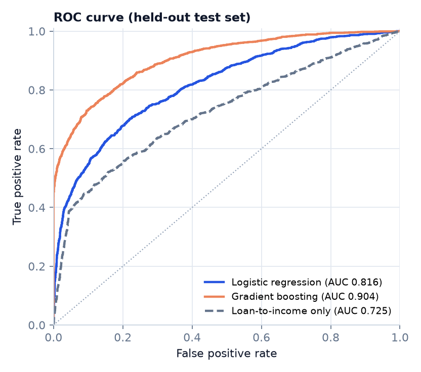
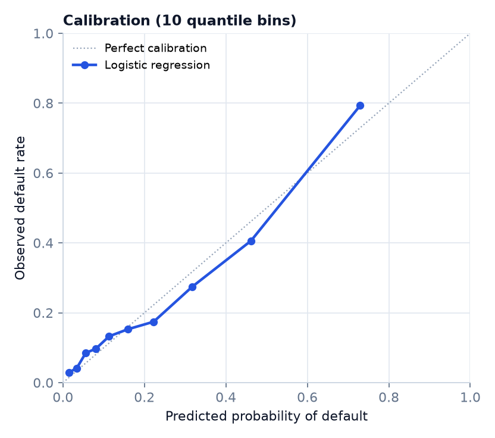

# RiskLens credit risk model

This folder trains the model that scores loan applications in the RiskLens API. It's written as a **model card**: what the model is, what it was trained on, how well it performs, and where it falls short.

## Quick start

```bash
cd ml
python -m venv .venv
.venv\Scripts\activate          # Windows  (macOS/Linux: source .venv/bin/activate)
pip install -r requirements.txt
python download_data.py         # ~2 MB, checksum-verified
python train.py                 # ~15 seconds on a laptop
```

`train.py` writes:

| File | Purpose |
|---|---|
| `backend/src/main/resources/model/credit_risk_model.json` | The model the Java API loads at startup |
| `ml/metrics.json` | Full evaluation report |
| `docs/model/roc_curve.png`, `docs/model/calibration.png` | Charts |

After retraining, run `mvn test` in `backend/`. `RiskModelTest` checks that Java reproduces Python's probabilities to 9 decimal places.

## Data

[Credit Risk Dataset](https://www.kaggle.com/datasets/laotse/credit-risk-dataset) on Kaggle (`laotse/credit-risk-dataset`): 32,581 personal loans with a `loan_status` outcome, where 1 means the borrower defaulted.

| Step | Rows |
|---|---|
| Raw | 32,581 |
| Exact duplicates removed | −165 |
| Implausible rows removed (age > 100, employment > 60 years) | −7 |
| **Clean** | **32,409** (21.9% defaulted) |

Missing employment length (887 rows) is filled with the **training-set** median, so no information from the test set leaks into training.

## Features

| Feature | How it's computed | Effect on risk |
|---|---|---|
| Loan-to-income | loan amount ÷ annual income | ↑ strongest driver |
| Income | log(annual income) | ↓ |
| Home ownership | one-hot: rent / mortgage / own / other | own ↓, rent ↑ |
| Previous default | 1 if a default is on file | ↑ |
| Loan purpose | one-hot, 6 categories | debt consolidation, home improvement ↑; venture, education ↓ |
| Employment length, age, credit history length | years | small effect |

All features are standardized with the training mean and standard deviation. Inputs outside the training range are clamped to it, so the model never extrapolates.

**Deliberately excluded:**
- **`loan_grade` and `loan_int_rate`.** The lender sets these *after* assessing the applicant's risk. Using them would leak the answer into the inputs and inflate the scores, and they wouldn't be available for a new applicant.
- **`log(loan amount)` as a separate feature.** Together with income and loan-to-income it made three features that carry the same information. The model then gave loan amount a *negative* weight ("bigger loans are safer"), which made the per-factor explanation nonsensical. Dropping it cost 0.004 AUC.

## Method

- Logistic regression (scikit-learn, L2 regularization, `C = 1.0`).
- Stratified 80/20 train/test split with `random_state = 42`.
- 5-fold cross-validation on the training set to check the result is stable.

## Results (held-out test set, 6,482 loans)

| Metric | Value | Meaning |
|---|---|---|
| **AUC** | **0.816** | 82% chance a random defaulter is ranked riskier than a random non-defaulter |
| Gini | 0.632 | 2 × AUC − 1, the usual credit-industry form |
| KS | 0.482 | Maximum separation between the score distributions of defaulters and non-defaulters |
| Brier score | 0.122 | Mean squared error of the probabilities (lower is better) |
| CV AUC | 0.816 ± 0.005 | Matches the test AUC, so there's no sign of overfitting |

**Risk bands.** The probability is turned into a label: < 15% → LOW, 15–40% → MEDIUM, ≥ 40% → HIGH.

| Band | Share of applicants | Predicted default rate | **Observed** default rate |
|---|---|---|---|
| LOW | 53% | 6.5% | 8.0% |
| MEDIUM | 28% | 25.3% | 21.6% |
| HIGH | 18% | 61.4% | 62.6% |

Predicted and observed rates match closely. That property is called **calibration**: when the model says "25%", about a quarter of those applicants really did default.

**Comparison:**

| Model | Test AUC |
|---|---|
| Loan-to-income ratio alone (baseline) | 0.725 |
| **Logistic regression (used)** | **0.816** |
| Gradient boosting (HistGradientBoosting) | 0.905 |

 

## Why logistic regression, when gradient boosting scores higher?

**Explainability.** Each applicant's score splits *exactly* into per-factor contributions, which is what the app's "What drove this score" panel shows:

```
log-odds = intercept + Σ coefficientᵢ × (xᵢ − meanᵢ) / scaleᵢ
```

Each term is how far one factor moves this applicant away from an average applicant. Lenders often have to explain a rejection to the applicant (adverse-action notices), and regulators expect models to be transparent. That's why scorecards built on logistic regression are still the industry standard. Gradient boosting would need an approximate add-on explainer such as SHAP, plus a separate serving runtime.

## Limitations

- **The dataset has an unrealistic "cliff".** Renters whose loan exceeds 30% of their income defaulted 96–100% of the time, against a gradual rise for everyone else. Real lending data rarely looks like that, which suggests the dataset is partly synthetic. A linear model can't represent a cliff, so it *under*-estimates risk for that group, and that accounts for most of the gap to gradient boosting. Adding an interaction feature (renter × high loan-to-income) would raise the AUC, but it would mostly be fitting a quirk of this dataset.
- **It isn't a real credit bureau.** There's no credit score, payment history or debt-to-income data, so the model sees far less than a real lender would.
- **No fairness review.** Age is a protected characteristic in many jurisdictions (e.g. under the US ECOA). It's kept here because it's in the dataset and has almost no effect (coefficient ≈ −0.01), but a production model would need a proper fairness review.
- **This is a demo.** The model must not be used for real lending decisions.
